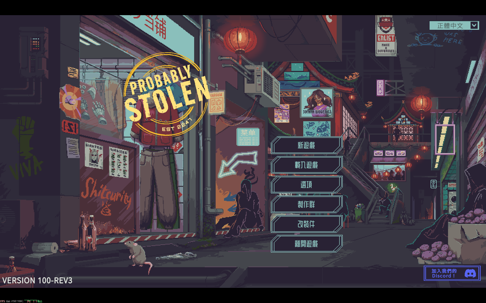
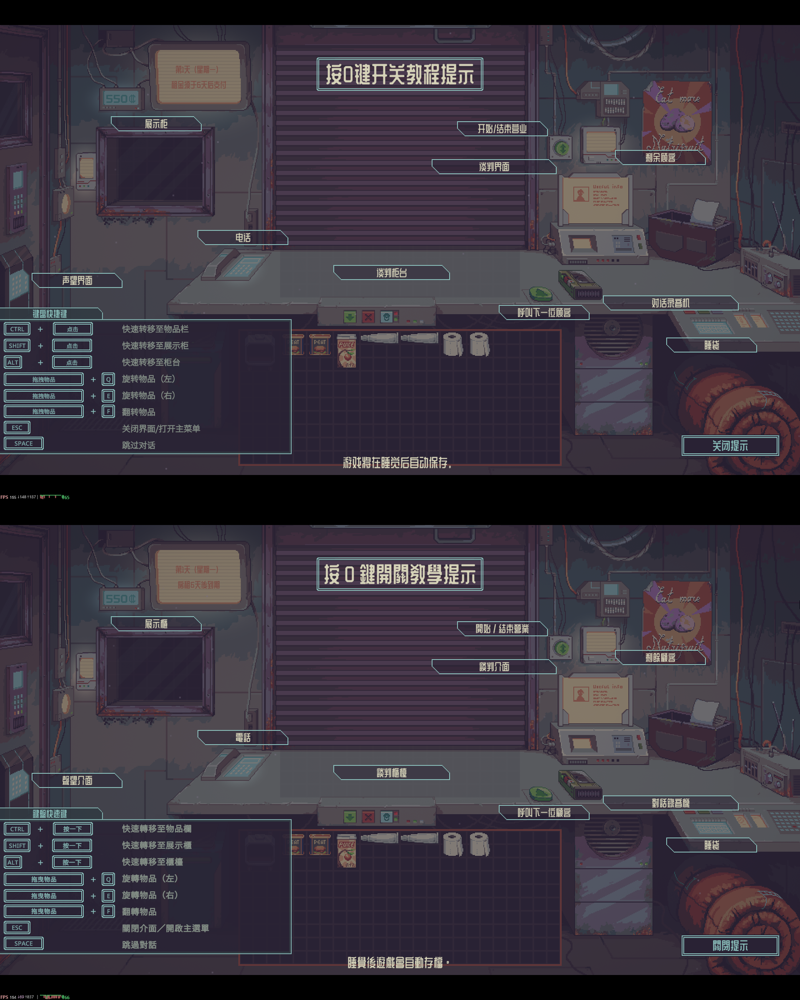
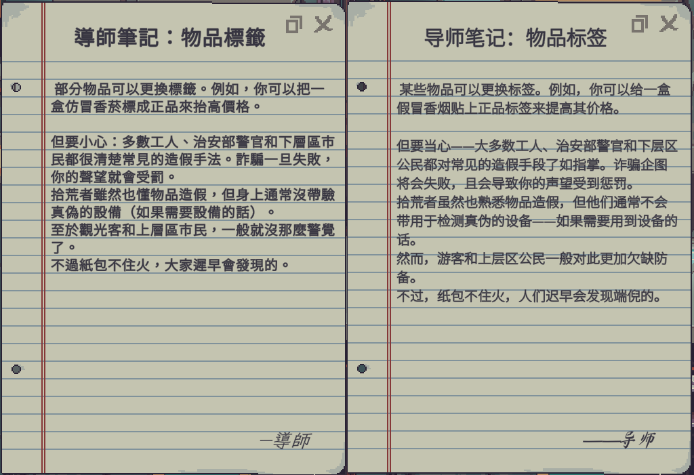
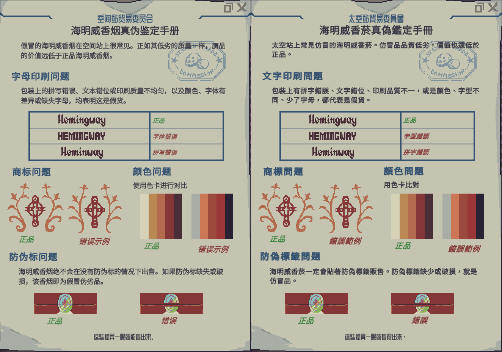
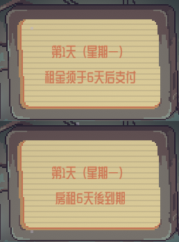

# Probably Stolen 正體中文（台灣）模組

《Probably Stolen》正式版的正體中文化模組，使用遊戲官方的模組系統，可從 Steam 工作坊訂閱。
以官方簡體中文為底本，依台灣用語與語感改寫遊戲文字，並把中文字型換成繁中字型。

- 語言選單會多出「正體中文」選項，選了就顯示本模組的譯文；原本的「Simplified Chinese」仍是遊戲原版的簡體中文。
- 不修改任何遊戲檔與存檔，停用模組就回到原版。
- 試玩版用的安裝程式在 [`demo` 分支](../../tree/demo)與 [v1.1.0](../../releases/tag/v1.1.0)，正式版請用本模組。



### 改寫前後對照

| 操作提示（上：原版簡體／下：本模組） | 導師筆記（左：本模組／右：原版簡體） |
|---|---|
|  |  |

| 香菸真偽鑑定手冊（左：原版簡體／右：本模組） | 房租提醒（上：原版簡體／下：本模組） |
|---|---|
|  |  |

## 安裝

### Steam 工作坊（建議）

1. 在[工作坊](https://steamcommunity.com/sharedfiles/filedetails/?id=3829248318)訂閱本模組，啟動遊戲。
2. 在主選單的「改裝件」（Mods）畫面啟用「Traditional Chinese (Taiwan)」，再重新啟動遊戲。
3. 在主選單右上角的語言選單選「正體中文」。

### 手動安裝

1. 到 [Releases](../../releases) 下載 `seacucu.zh-tw.zip`。
2. 關閉遊戲，把壓縮檔裡的 `seacucu.zh-tw` 資料夾解壓縮到遊戲資料夾的 `Mods` 底下（變成 `Mods\seacucu.zh-tw\manifest.xml`）。
   遊戲資料夾：Steam 遊戲庫 → 在遊戲上按右鍵 → 管理 → 瀏覽本機檔案。
3. 照上面的第 2、3 步啟用並選擇語言。

更新時先刪掉舊的 `Mods\seacucu.zh-tw` 資料夾再解壓縮。

### 注意

- 請停用其他中文翻譯模組，同時啟用會互相干擾。
- 遊戲更新後，原文有變動的句子會先顯示遊戲原本的簡體中文，等本模組更新後再換成譯文，不會顯示過時的內容。
- 用簡體中文玩過的舊存檔可以直接沿用（v1.4.0 起）：遊戲寫進存檔的物品名稱、帳單、新聞等文字，會在顯示時換成譯文，存檔本身不會被修改。

## 譯文進度

| 來源 | 條數 | 狀態 |
|---|---|---|
| 試玩版譯文（原文未變） | 5,288 | 已逐條潤飾 |
| 正式版新增或修改 | 1,393 | 已逐條潤飾 |

歡迎在 [Issues](../../issues) 回報不順或錯誤的譯文。

## 字型

| 用途 | 原字型 | 替換為 |
|---|---|---|
| 內文 | Noto Sans SC | [源樣黑體 GenYo Gothic 2 TW](https://github.com/ButTaiwan/genyog-font) Light（ButTaiwan），字距 +0.05 em，行距沿用西文 Noto Sans |
| 標題 | WDXL Lubrifont SC | [WDXL Lubrifont TC](https://fonts.google.com/specimen/WDXL+Lubrifont+TC) |
| 手寫 | Ma Shan Zheng | [霞鶩文楷 TC](https://github.com/lxgw/LxgwWenkaiTC) |

三套字型皆以 SIL Open Font License 1.1 授權，授權全文見 `mod/fonts/OFL-*.txt`。

## 運作方式

模組（`src/`）透過 Harmony 掛在遊戲的這幾個地方：

| 位置 | 作用 |
|---|---|
| `LocalizedStringDatabase.GenerateLocalizedString` | 遊戲第一次用到某張簡中字串表時，把表內條目換成譯文（同時記下原文，切回簡體中文時換回去）。每條譯文附有簡中原文的雜湊，原文對不上就保留原文 |
| `FontLoader.GetFontByRole` | 選正體中文時，把簡中字型資產換成用模組字型檔即時建立的繁中字型資產 |
| `TMP_Text.text`、`TMP_Text.SetText` | 遊戲先前組好並存進存檔的簡中文字（物品、帳單、新聞、客人名稱），顯示時對照字串表原文換成譯文：整句相同、`{0}` 句型相符，或長句中出現的原文片段。只換畫面上的文字，不改遊戲資料與存檔 |
| `MainMenuUIController.HandleLocaleDropdown`、`OnLocaleChanged` | 在語言選單最後加上「正體中文」。兩個中文選項都用遊戲的中文語系（`zh`），選哪一個決定顯示譯文或原版簡中，並存進遊戲設定 |

模組不需要任何額外權限（遊戲的模組掃描不會偵測到檔案、網路等能力），檔案一律透過 `ModHelper` 讀取。

## 建置與上架

需要 .NET SDK（6 以上）與已安裝的遊戲（編譯時參照遊戲的 `Managed` 組件，不會一起打包）。

```
tools\build.ps1             # 編譯並組出 dist\seacucu.zh-tw\ 與 dist\seacucu.zh-tw.zip
tools\build.ps1 -Install    # 同上，並複製到遊戲的 Mods\ 測試
gh release create v1.3.0 dist\seacucu.zh-tw.zip --notes "更新說明"   # 發佈，並自動上傳到工作坊
```

- 遊戲不在預設位置時，加上 `-GameDir <遊戲資料夾>`。
- 在 Mods 畫面替本機這份模組開啟開發者模式後，遊戲中按 F7 可在正體與簡體中文之間切換，方便對照與截圖。
- 發佈 GitHub Release 時，`.github/workflows/workshop.yml` 會把附檔 `seacucu.zh-tw.zip` 上傳到 `workshop/publishedfileid.txt` 指定的工作坊項目，
  Release 說明會成為工作坊的更新說明。工作坊頁面的標題、說明與預覽圖取自 main 分支的 `workshop/title.txt`、`description.txt`、`preview.png`，每次上傳都會覆寫。
  SteamCMD 只能寫入預設（英文）區，兩區都用同一份中文。工作坊頁面另有正體中文區時，要切換到該語言後把同樣的標題與說明手動貼上。
  正式版（非預先發行）會順便把項目設為公開。
- SteamCMD 也不能設定工作坊標籤。要改標籤時，用項目擁有者的帳號登入 Steam 用戶端，再執行 `dotnet run --project tools\WorkshopTags -- Mod Translation`。
  要重傳某個版本，可在 Actions 頁面手動執行「Workshop upload」並填入標籤。
- 上傳需要兩個 repo secrets：`STEAM_USERNAME`，以及 `STEAM_CONFIG_VDF`（在自己電腦用 [SteamCMD](https://developer.valvesoftware.com/wiki/SteamCMD) 登入成功後，`config/config.vdf` 的 base64）。
  其中存的是登入權杖，不含密碼；權杖失效、上傳顯示登入失敗時，重新登入 SteamCMD 再更新這個 secret。
- 譯文 `mod/data/strings.json` 由另外的譯文流程產生（內含開發商原文，不放在本 repo）。

## 授權

- 程式碼：MIT License（見 `LICENSE`）
- 字型：SIL Open Font License 1.1
- 譯文（`mod/data/strings.json`）：改寫自遊戲官方文本，遊戲內容版權屬 Questing Goose Studio 所有。

本專案為非官方玩家自製模組，與開發商、發行商無關。
