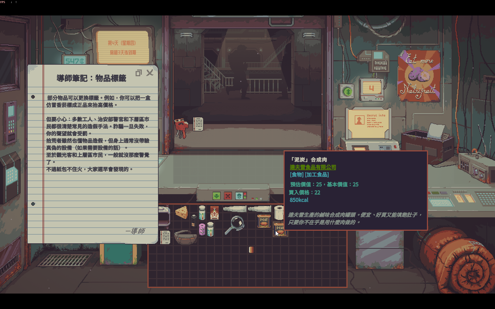

# Probably Stolen 繁體中文（台灣）模組

為《Probably Stolen》試玩版（Steam：Probably Stolen Demo）製作的繁體中文化補丁。
以官方簡體中文為底本，依台灣用語與語感改寫全部 5,596 條字串，並把中文字型換成繁中字型。

- 安裝後，簡體中文選項會改為「繁體中文」，原本的簡體中文會被取代。
- 補丁只在你自己的電腦上修改遊戲檔，散布的內容只有譯文、字型和本程式，不含任何遊戲原始檔。
- 安裝前會自動備份原檔，可以隨時一鍵還原。



<sub>1.0 版畫面。1.1 版起內文改用源樣黑體，行距也已對齊筆記本格線。</sub>

## 安裝

1. 到 [Releases](../../releases) 下載 `ProbablyStolen-zhTW-Patcher.exe`。
2. 關閉遊戲，執行補丁程式。程式會自動從 Steam 收藏庫找到遊戲資料夾；找不到時請按「瀏覽…」手動指定（含 `Probably Stolen.exe` 的資料夾）。
3. 按「安裝／重新安裝」，約需 20 秒到 1 分半。
4. 啟動遊戲，在主選單右上角的語言選單選「繁體中文」。

遊戲裝在 `C:\Program Files (x86)` 底下時，若出現權限錯誤，請對補丁程式按右鍵，選「以系統管理員身分執行」。

### 還原

- 執行補丁程式，按「還原原版」；或
- Steam →「Probably Stolen Demo」→ 內容 → 已安裝檔案 →「驗證遊戲檔案的完整性」。

### 遊戲更新後

Steam 更新遊戲時可能會覆蓋模組，重新執行補丁程式即可。
如果更新改動了相關檔案，補丁程式會提示「遊戲版本不同」；可勾選「強制安裝」嘗試，失敗時程式不會寫入任何檔案。

## 補丁修改的檔案

| 檔案（`Probably Stolen_Data\` 底下） | 修改內容 |
|---|---|
| `StreamingAssets\aa\StandaloneWindows64\localization-string-tables-chinese(simplified)(zh)_assets_all.bundle` | 簡中字串表的文字換成繁中譯文 |
| `StreamingAssets\aa\catalog.json` | 停用上述字串表的 CRC 檢查，讓修改後的檔案能載入 |
| `sharedassets0.assets` | 三套中文字型換成繁中字型；西文字型加掛中文備援字型 |
| `level0` | 語言選單的「Simplified Chinese」改為「繁體中文」 |

原檔備份在遊戲資料夾的 `zhTW_backup\`。

## 字型

| 用途 | 原字型 | 替換為 |
|---|---|---|
| 內文 | Noto Sans SC | [源樣黑體 GenYo Gothic 2 TW](https://github.com/ButTaiwan/genyog-font)（ButTaiwan） |
| 標題 | WDXL Lubrifont SC | [WDXL Lubrifont TC](https://fonts.google.com/specimen/WDXL+Lubrifont+TC) |
| 手寫 | Ma Shan Zheng | [霞鶩文楷 TC](https://github.com/lxgw/LxgwWenkaiTC) |

三套字型皆以 SIL Open Font License 1.1 授權，授權全文見 `data/fonts/OFL-*.txt`。

## 從原始碼執行與建置

需要 Python 3.11 以上。

```
pip install -r requirements.txt
python -m zhtw_patcher            # 圖形介面
python -m zhtw_patcher status     # 指令列：status / install / restore，可加 --game <資料夾> --force
build.bat                         # 用 PyInstaller 打包成 dist\ProbablyStolen-zhTW-Patcher.exe
```

`data/typetrees.json` 是 TextMeshPro 字型資產與下拉選單的結構定義，由 `dev/export_typetrees.py` 從 Cpp2IL 產生的 dummy DLL 匯出；玩家端不需要反編譯任何東西。

## 授權

- 程式碼：MIT License（見 `LICENSE`）
- 字型：SIL Open Font License 1.1
- 譯文（`data/strings.json`）：改寫自遊戲官方文本，遊戲內容版權屬 Questing Goose Studio／tinyBuild 所有。

本專案為非官方玩家自製模組，與開發商、發行商無關。
